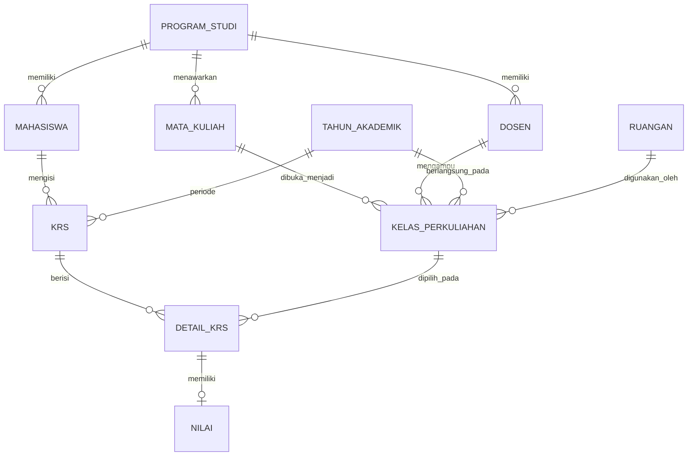

# Sistem Informasi Akademik


Aplikasi web **Sistem Informasi Akademik** yang dibangun dengan **Oracle APEX** dan **Oracle SQL**. Aplikasi mengelola data program studi, mahasiswa, dosen, mata kuliah, tahun akademik, ruangan, kelas perkuliahan, KRS, dan nilai, lengkap dengan dashboard ringkasan dan tampilan bertema gelap-emas.

> Proyek ini dibuat untuk keperluan tugas praktikum basis data. Seluruh data contoh bersifat fiktif.

## Screenshot

| Home | Program Studi |
|---|---|
| ![Home]
(docs/screenshots/home.png) |  |

| KRS (Master-Detail) | Nilai Mahasiswa |
|---|---|
|  |  |

## Fitur

- **Dashboard Home**: total mahasiswa, dosen, mata kuliah, dan kelas, grafik mahasiswa per program studi, serta ringkasan periode aktif. Angka dihitung langsung dari database.
- **Data master** (tambah, ubah, hapus, cari): Program Studi, Mahasiswa, Dosen, Mata Kuliah, Tahun Akademik, dan Ruangan.
- **Transaksi akademik**: Kelas Perkuliahan, KRS dengan halaman *master-detail* (KRS dan Detail KRS), serta Nilai.
- **Laporan** berbasis view: Jadwal Kelas, KRS Mahasiswa, Nilai Mahasiswa, dan IPS Mahasiswa.
- **Integritas data** dengan primary key, foreign key, dan constraint `UNIQUE (ID_KRS, ID_KELAS)` agar mahasiswa tidak mengambil kelas yang sama dua kali pada satu KRS.
- **Antarmuka kustom**: tema gelap-emas, animasi, dan efek 3D, dibuat dengan CSS dan sedikit JavaScript.

## Desain database



| Tabel | Fungsi |
|---|---|
| `PROGRAM_STUDI` | Data program studi |
| `MAHASISWA` | Data mahasiswa |
| `DOSEN` | Data dosen |
| `MATA_KULIAH` | Data mata kuliah beserta SKS dan semester |
| `TAHUN_AKADEMIK` | Periode akademik dan statusnya |
| `RUANGAN` | Data ruangan dan kapasitas |
| `KELAS_PERKULIAHAN` | Kelas, dosen pengampu, ruangan, dan jadwal |
| `KRS` | Kartu rencana studi mahasiswa per periode |
| `DETAIL_KRS` | Kelas yang dipilih pada sebuah KRS |
| `NILAI` | Nilai angka dan huruf per pengambilan kelas |

## Struktur repositori

```
.
├── sql/
│   ├── 01_create_tables.sql     # membuat 10 tabel
│   ├── 02_insert_data.sql       # data contoh + COMMIT
│   ├── 03_views.sql             # 6 view untuk laporan dan dashboard
│   ├── 04_check.sql             # cek tabel yang terbuat
│   └── 99_reset_drop_all.sql    # hapus semua objek (untuk mengulang)
├── apex/
│   ├── home/                    # kode halaman Home (PL/SQL, CSS, JS)
│   └── global/                  # tema untuk seluruh halaman (Global Page)
├── docs/screenshots/            # gambar untuk README
├── LICENSE
└── README.md
```

## Cara menjalankan

**Prasyarat:** workspace Oracle APEX (misalnya gratis di [apex.oracle.com](https://apex.oracle.com)).

1. **Siapkan database.** Buka *SQL Workshop → SQL Scripts*, lalu jalankan berurutan: `01_create_tables.sql`, `02_insert_data.sql`, dan `03_views.sql`. Pastikan tidak ada error pada hasilnya.
2. **Buat aplikasi.** Di *App Builder*, pilih *Create → New Application* dengan nama `Sistem Informasi Akademik`.
3. **Buat halaman.** Tambahkan *Interactive Report with Form* untuk tiap tabel master, kelas, dan nilai. Gunakan *Master Detail* untuk `KRS` dan `DETAIL_KRS`. Buat *Interactive Report* dari view untuk halaman laporan.
4. **Pasang tema.**
   - *Global Page (Page 0)*: isi region Static Content dengan `apex/global/global_region.html`.
   - *Page 1 (Home)*: buat region *Dynamic Content* dari `apex/home/home_region.plsql.sql`, tempel `apex/home/home.css` pada *CSS → Inline*, dan `apex/home/home_page_load.js` pada *Execute when Page Loads*.
5. Jalankan aplikasi.

Untuk mengulang dari awal, jalankan `sql/99_reset_drop_all.sql`.

## Contoh query

```sql
-- Total SKS yang diambil setiap mahasiswa
SELECT M.NIM, M.NAMA_MAHASISWA, SUM(MK.SKS) AS TOTAL_SKS
FROM MAHASISWA M
JOIN KRS K                ON M.NIM = K.NIM
JOIN DETAIL_KRS DK        ON K.ID_KRS = DK.ID_KRS
JOIN KELAS_PERKULIAHAN KP ON DK.ID_KELAS = KP.ID_KELAS
JOIN MATA_KULIAH MK       ON KP.KODE_MK = MK.KODE_MK
GROUP BY M.NIM, M.NAMA_MAHASISWA;
```

## Rencana pengembangan

- Validasi batas SKS dan jadwal bentrok pada KRS
- Halaman transkrip dan KHS per mahasiswa
- Hak akses berdasarkan peran (admin, dosen, mahasiswa)
- Pengisian nilai huruf otomatis dari nilai angka

## Teknologi

Oracle APEX, Oracle SQL dan PL/SQL, HTML, CSS, JavaScript.

## Pembuat

**Rizky Maulana**  
[GitHub](https://github.com/USERNAME-ANDA) · [LinkedIn](https://linkedin.com/in/USERNAME-ANDA)

## Lisensi

Dirilis dengan lisensi MIT. Lihat berkas [LICENSE](LICENSE).
